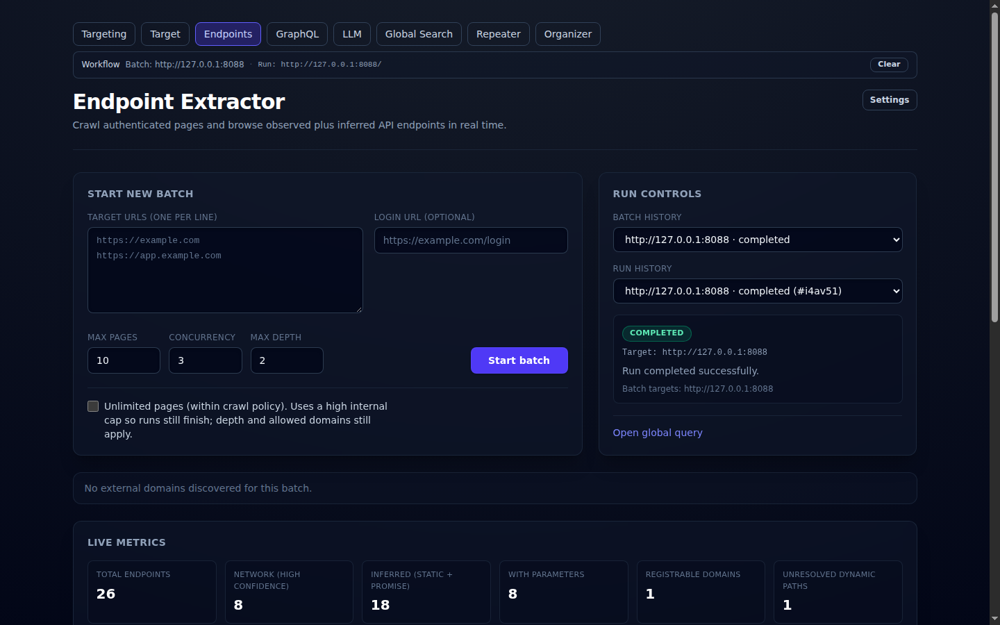

# Endpoint Extractor

[](https://github.com/burakturksever/endpoint-extractor/actions/workflows/ci.yml)
[](LICENSE)

A recon tool for web application security testing. It drives a real Chromium browser with Playwright, records the API calls a page actually makes, and statically analyses the shipped JavaScript to find endpoints the crawl never triggered. You review the results in a local Next.js UI, and a **local LLM** can optionally group and explain what was found, without sending your target's data to a cloud API.

> [!WARNING]
> **This project was heavily vibe-coded.** I built it to support my own pentest workflow, not as a polished product. Expect bugs, rough edges, performance problems on large targets and code that could use optimisation. Issues and PRs are welcome.



## Features

- **Runtime capture:** XHR/fetch traffic seen during the crawl is recorded as high-confidence endpoints, with the method and parameters observed.
- **Static and promise-chain JS analysis:** loaded scripts are parsed with Babel to infer endpoints from string literals, template literals, concatenation and `fetch`/promise chains. Each result is tagged with its source (`network`, `static` or `promise`) and a confidence level.
- **Login-assisted crawling:** a headed browser hand-off for authenticated targets, plus batch crawls that respect depth/page limits and per-domain allow/deny decisions.
- **GraphQL:** endpoint detection and schema enumeration.
- **Repeater:** replay and edit any captured request.
- **Target tree and global search:** browse endpoints as a path hierarchy, or query across every run.
- **Local LLM assistance:** feature clustering and per-endpoint explanations from a model on your own machine. See [Local LLM features](#local-llm-features).
- **Live UI:** progress is streamed over SSE, and run history is kept in SQLite (default) or Postgres.


## Local LLM features

The LLM features are designed to run on a **local model**, so crawl data, endpoints and JavaScript snippets from your target stay on your machine. They work with any OpenAI-compatible server, such as [LM Studio](https://lmstudio.ai/), Ollama, llama.cpp or vLLM, and were built around small instruct models (7–8B, such as Qwen).

- **Endpoint clustering** (LLM tab): groups a run's endpoints into readable feature areas, such as authentication, billing or user management. That makes it much quicker to see an app's attack surface and decide what to test first.
  - Large runs are sent to the model in chunks and merged, up to 25 clusters.
  - Noise such as social widgets, help desks and static assets is filtered into a *Miscellaneous* bucket before it reaches the model.
  - Each endpoint gets one primary cluster plus secondary tags, so the list stays deduplicated.
  - Results are saved per run, so you don't pay for inference twice.
- **Explain endpoint** (endpoint details drawer): sends one endpoint to the model and gets back a short explanation of what it probably does. The model sees the method, resolved URL, inferred parameters, how the endpoint was found and the raw JS expression it came from. This is useful for working out obscure or partially resolved paths.

How it works:

- LLM features are **off by default**. Turn them on in **Settings**, set the base URL (default `http://127.0.0.1:1234/v1`) and the model name, and use **Test connection** to check it. An API key is optional.
- The model is only called when you click something. It never runs during a crawl, and the explain calls are rate-limited.
- In Docker, `LM_STUDIO_BASE_URL` overrides the stored base URL. That makes it easy to reach a model running on the host, as shown under [Docker](#docker).
- If you point the base URL at a hosted provider instead, the endpoint data is sent there. Keep that in mind for client engagements.

## Responsible use

Only run this tool against applications you own or have explicit written permission to test.

The app has **no authentication**, and its repeater can send arbitrary HTTP requests from your machine. For that reason the `dev` and `start` scripts bind to `127.0.0.1`. Do not expose it on a network you don't trust.

## Quick start

Requirements: Node.js 20.9 or newer.

```bash
npm install
npx playwright install chromium
cp .env.example .env
npm run prisma:generate
npx prisma db push
npm run dev
```

Then open http://127.0.0.1:3000, enter a target URL and click **Start batch**.

On Linux the crawler runs headless by default. To use the login hand-off, set `HEADED_BROWSER=true` and run it from a desktop session.

### Postgres (optional)

SQLite works fine for local use. For larger datasets, run Postgres in Docker and keep the app native:

```bash
npm run infra:postgres:up   # binds to 127.0.0.1:5432
# set DATABASE_URL in .env, see .env.example
npm run prisma:generate:postgres
npm run prisma:dbpush:postgres
npm run dev
```

See [docs/migrate-sqlite-to-postgres.md](docs/migrate-sqlite-to-postgres.md) for details.

### Docker

```bash
docker build -t endpoint-extractor .
docker run --rm -p 127.0.0.1:3000:3000 endpoint-extractor
```

To reach an LLM server running on the host from inside the container, set `LM_STUDIO_BASE_URL=http://host.docker.internal:1234/v1`.

## Planned features

These are on the roadmap but aren't implemented yet, and some are still at the design stage:

- **Automated IDOR testing:** swap object identifiers between authenticated sessions and flag responses that leak another user's data. See [docs/idor-automation-backlog.md](docs/idor-automation-backlog.md) for the open design questions.
- **Automated BOLA testing:** API-focused broken object-level authorization checks across discovered endpoints and HTTP methods, with strict scope and rate limits.
- **Burp Suite integration:** send discovered endpoints to Burp, or import Burp history and sitemaps, so this tool fits into an existing workflow.
- **Source viewer:** jump from an inferred endpoint to the exact location in the pretty-printed JavaScript it was extracted from, with the surrounding code highlighted.
- **Rewrite of the performance-critical parts:** if the TypeScript/Node implementation keeps struggling on large targets, the crawler and analysis engine may move to a faster language.

## Development

```bash
npm run lint
npm run typecheck
npm test            # Vitest unit tests + coverage
npm run test:e2e    # Playwright smoke test
npm run build
```

## Health endpoints

- `GET /api/health`: liveness
- `GET /api/health/deps`: database and LLM dependency checks

## Project layout

```
src/app/            Next.js pages and API routes
src/components/     UI components
src/lib/extract/    network capture, JS static + promise analysis, normalization
src/lib/runner/     Playwright runner, crawl policy/limits, batch orchestration
src/lib/graphql/    GraphQL detection and enumeration
src/lib/llm/        OpenAI-compatible client for clustering/explanations
prisma/             SQLite and Postgres schemas
```

## License

I want this tool to stay free for fellow penetration testers, security engineers, bug bounty hunters and anyone else who finds it useful. It was vibe-coded to help my own workflow and I'm handing it out for free. I don't want to profit from it, and I don't want anyone else to either.

It's released under the [MIT License with the Commons Clause](LICENSE):

- **You can** use it for free for any work, including paid pentests, client assessments, bug bounties and your day job. You can also study it, modify it, fork it and share your fork for free.
- **You can't** sell it, or make money from distributing it. That includes selling copies or modified versions, offering it as a hosted or managed service, and charging for support of it.

Forks must keep this license notice, so the no-selling condition carries over to them too. If you're not sure whether your use is allowed, open an issue and ask.
