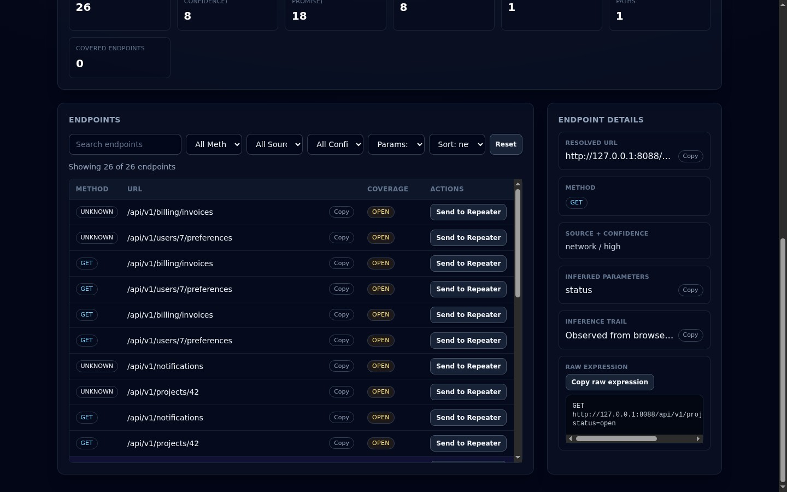

# Endpoint Extractor

[](https://github.com/burakturksever/endpoint-extractor/actions/workflows/ci.yml)
[](LICENSE)

A recon tool for web application security testing. It drives a real Chromium browser with Playwright, records the API calls a page actually makes, and statically analyses the shipped JavaScript to find endpoints the crawl never triggered. You review the results in a local Next.js UI.


## Features

- **Runtime capture:** XHR/fetch traffic seen during the crawl is recorded as high-confidence endpoints, with the method and parameters observed.
- **Static and promise-chain JS analysis:** loaded scripts are parsed with Babel to infer endpoints from string literals, template literals, concatenation and `fetch`/promise chains. Each result is tagged with its source (`network`, `static` or `promise`) and a confidence level.
- **Login-assisted crawling:** a headed browser hand-off for authenticated targets, plus batch crawls that respect depth/page limits and per-domain allow/deny decisions.
- **GraphQL:** endpoint detection and schema enumeration.
- **Repeater:** replay and edit any captured request.
- **Target tree and global search:** browse endpoints as a path hierarchy, or query across every run.
- **Optional local LLM:** endpoint clustering and explanations through any OpenAI-compatible server (for example LM Studio).
- **Live UI:** progress is streamed over SSE, and run history is kept in SQLite (default) or Postgres.



## Responsible use

Only run this tool against applications you own or have explicit written permission to test.

The app has **no authentication**, and its repeater can send arbitrary HTTP requests from your machine. For that reason the `dev` and `start` scripts bind to `127.0.0.1`. Do not expose it on a network you don't trust.

## Quick start

Requirements: Node.js 20.9 or newer.

```bash
npm install
npx playwright install chromium
cp .env.example .env
npm run prisma:generate
npx prisma db push
npm run dev
```

Then open http://127.0.0.1:3000, enter a target URL and click **Start batch**.

On Linux the crawler runs headless by default. To use the login hand-off, set `HEADED_BROWSER=true` and run it from a desktop session.

### Postgres (optional)

SQLite works fine for local use. For larger datasets, run Postgres in Docker and keep the app native:

```bash
npm run infra:postgres:up   # binds to 127.0.0.1:5432
# set DATABASE_URL in .env, see .env.example
npm run prisma:generate:postgres
npm run prisma:dbpush:postgres
npm run dev
```

See [docs/migrate-sqlite-to-postgres.md](docs/migrate-sqlite-to-postgres.md) for details.

### Docker

```bash
docker build -t endpoint-extractor .
docker run --rm -p 127.0.0.1:3000:3000 endpoint-extractor
```

To reach an LLM server running on the host from inside the container, set `LM_STUDIO_BASE_URL=http://host.docker.internal:1234/v1`.

## Development

```bash
npm run lint
npm run typecheck
npm test            # Vitest unit tests + coverage
npm run test:e2e    # Playwright smoke test
npm run build
```

## Health endpoints

- `GET /api/health`: liveness
- `GET /api/health/deps`: database and LLM dependency checks

## Project layout

```
src/app/            Next.js pages and API routes
src/components/     UI components
src/lib/extract/    network capture, JS static + promise analysis, normalization
src/lib/runner/     Playwright runner, crawl policy/limits, batch orchestration
src/lib/graphql/    GraphQL detection and enumeration
src/lib/llm/        OpenAI-compatible client for clustering/explanations
prisma/             SQLite and Postgres schemas
```

## License

[PolyForm Noncommercial 1.0.0](LICENSE). You're free to use, study, modify and share this for any noncommercial purpose, including personal projects, research, education and hobby work, and use by charities, schools and public bodies.

Commercial use is not permitted. That includes selling the tool or a modified version, and offering it as a paid service.
